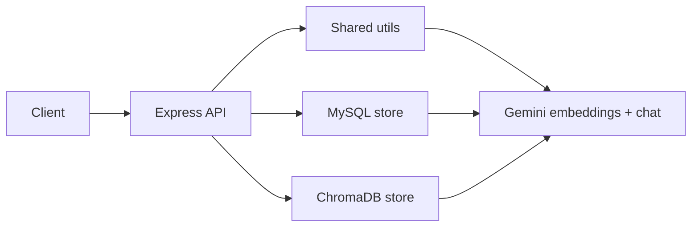
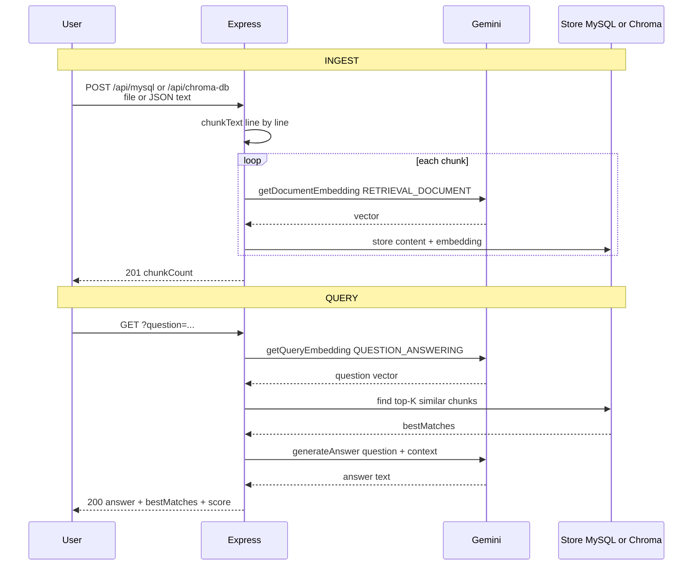
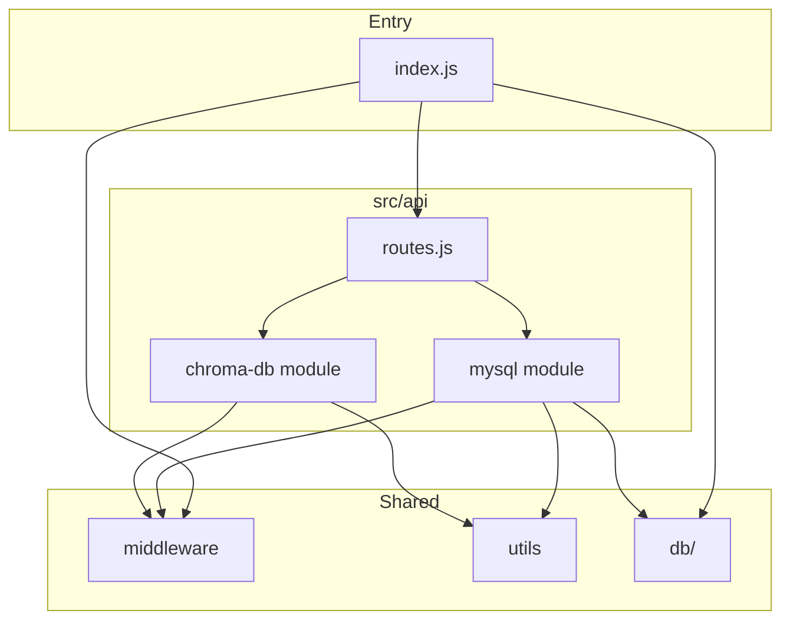
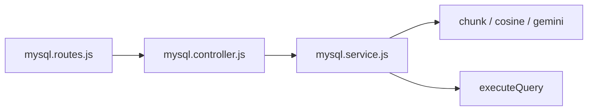
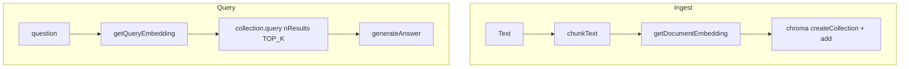
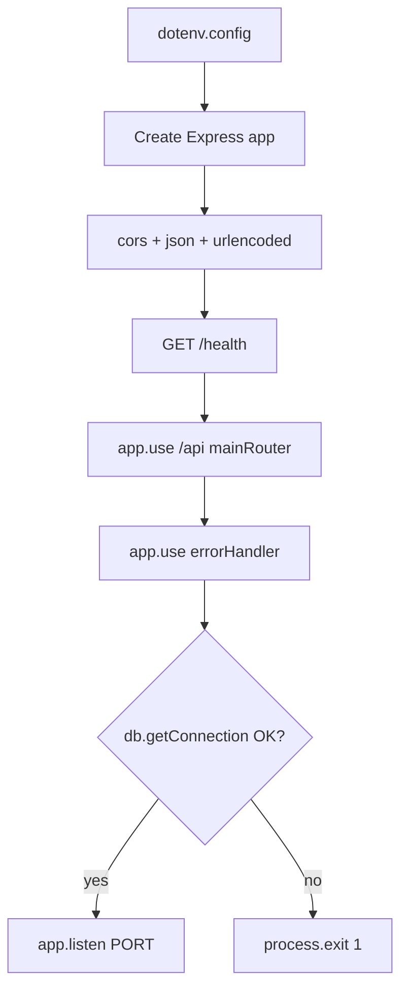
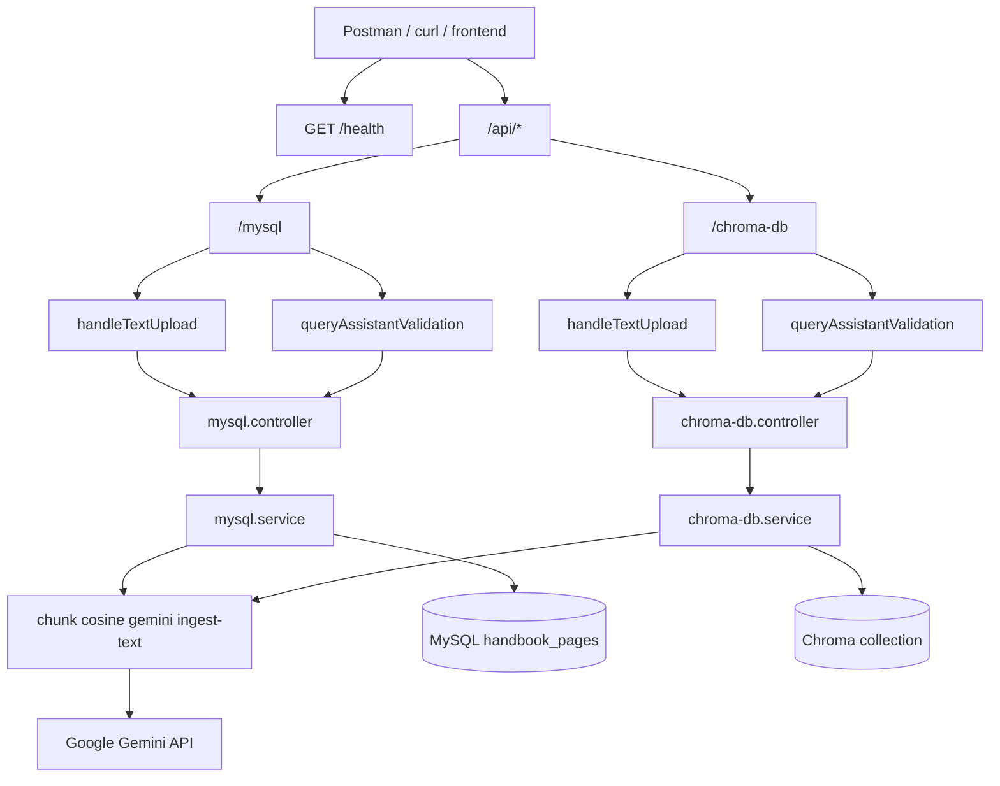
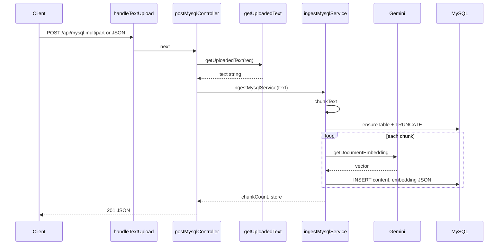
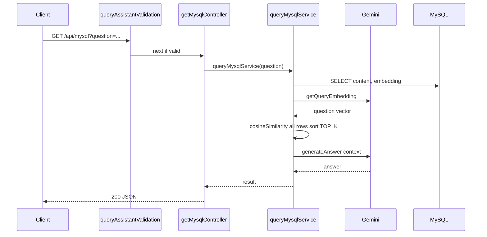
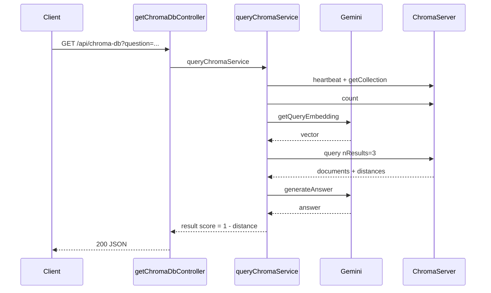

# RAG Demo Backend — Step-by-Step Implementation Walkthrough

This document explains the RAG demo backend with **MySQL** and **ChromaDB** as the two vector-store demos.

Every code block below is meant to be **copy-pastable** and matches the current codebase. Build in order: each step depends on the ones before it.

---

## What you will build

A Node.js **Express** API that demonstrates **Retrieval-Augmented Generation (RAG)**:

1. **Ingest** — upload a `.txt` handbook → split into chunks → embed with **Gemini** → store vectors  
2. **Query** — embed the user’s question → find nearest chunks → ask Gemini to answer **only** from that context  

Two storage backends share the same RAG idea:

| Backend   | How search works                                      | Why it matters           |
| --------- | ----------------------------------------------------- | ------------------------ |
| MySQL     | Store embeddings as JSON; score all rows in JavaScript | Brute-force / fundamentals |
| ChromaDB  | Dedicated vector DB with nearest-neighbor query         | Real vector search       |



---

## Table of contents

1. [Part 0 — Concepts (RAG in one picture)](#part-0--concepts-rag-in-one-picture)
2. [Part 1 — Project setup](#part-1--project-setup)
3. [Part 2 — Environment variables](#part-2--environment-variables)
4. [Part 3 — MySQL schema & DB config](#part-3--mysql-schema--db-config)
5. [Part 4 — Shared utilities](#part-4--shared-utilities)
6. [Part 5 — Middleware](#part-5--middleware)
7. [Part 6 — Shared validation](#part-6--shared-validation)
8. [Part 7 — MySQL RAG module](#part-7--mysql-rag-module)
9. [Part 8 — ChromaDB RAG module](#part-8--chromadb-rag-module)
10. [Part 9 — Wire routes & boot the server](#part-9--wire-routes--boot-the-server)
11. [Part 10 — Run, ingest, and query](#part-10--run-ingest-and-query)
12. [Part 11 — Request flow diagrams](#part-11--request-flow-diagrams)
13. [Appendix — Final folder tree & endpoint map](#appendix--final-folder-tree--endpoint-map)

---

## Part 0 — Concepts (RAG in one picture)



**Key idea:** the LLM does **not** memorize your handbook. You **retrieve** relevant lines first, then the model answers from those lines only.

---

## Part 1 — Project setup

### Step 1.1 — Create the project root

```bash
mkdir rag-demo-backend
cd rag-demo-backend
npm init -y
```

### Step 1.2 — Enable ES modules

In `package.json`, set `"type": "module"` (this project uses `import` / `export`, not `require`).

### Step 1.3 — Install dependencies

```bash
npm install express cors dotenv mysql2 multer express-validator http-status-codes @google/genai chromadb
npm install -D nodemon
```

### Step 1.4 — Final `package.json`

Use this shape (scripts + deps):

```json
{
  "name": "rag-demo-backend",
  "version": "1.0.0",
  "description": "RAG demo API with MySQL and ChromaDB",
  "main": "index.js",
  "type": "module",
  "scripts": {
    "chroma": "npx chroma run --path ./chroma-data",
    "dev": "nodemon index.js",
    "start": "node index.js"
  },
  "dependencies": {
    "@google/genai": "^1.52.0",
    "chromadb": "^3.4.3",
    "cors": "^2.8.6",
    "dotenv": "^17.3.1",
    "express": "^5.2.1",
    "express-validator": "^7.3.1",
    "http-status-codes": "^2.3.0",
    "multer": "^2.0.2",
    "mysql2": "^3.19.1"
  }
}
```

### Step 1.5 — `.gitignore`

```gitignore
node_modules
.env

chroma-data
```

### Step 1.6 — Folder layout to create

```text
rag-demo-backend/
├── index.js
├── .env.example
├── .gitignore
├── package.json
├── evangadi-info.txt          # sample handbook (one fact per line)
├── db/
│   ├── schema.sql
│   └── db.config.js
└── src/
    ├── api/
    │   ├── routes.js
    │   ├── shared/validation/rag.validation.js
    │   ├── mysql/
    │   │   ├── routes/mysql.routes.js
    │   │   ├── controller/mysql.controller.js
    │   │   └── service/mysql.service.js
    │   └── chroma-db/
    │       ├── routes/chroma-db.routes.js
    │       ├── controller/chroma-db.controller.js
    │       └── service/chroma-db.service.js
    ├── middleware/
    │   ├── error-handler.js
    │   ├── upload.js
    │   └── validation-handler.js
    └── utils/
        ├── chunk.js
        ├── cosine.js
        ├── gemini.js
        └── ingest-text.js
```



---

## Part 2 — Environment variables

### Step 2.1 — Create `.env.example`

Copy this file, then copy it to `.env` and fill in secrets.

```env
PORT=3788

DB_HOST=localhost
DB_PORT=3306
DB_USER=root
DB_PASS=
DB_NAME=evangadi_demo

GEMINI_API_KEY=
GEMINI_EMBEDDING_MODEL=gemini-embedding-001
GEMINI_CHAT_MODEL=gemini-2.5-flash-lite

CHROMA_HOST=http://localhost:8000
CHROMA_COLLECTION=evangadi-handbook
```

### Step 2.2 — Variable roles

| Variable                 | Used by              | Purpose                                      |
| ------------------------ | -------------------- | -------------------------------------------- |
| `PORT`                   | `index.js`           | HTTP port (default `3788`)                   |
| `DB_*`                   | `db/db.config.js`    | MySQL pool                                   |
| `GEMINI_API_KEY`         | `src/utils/gemini.js`| Auth for embeddings + answers                |
| `GEMINI_EMBEDDING_MODEL` | `gemini.js`          | Embedding model id                           |
| `GEMINI_CHAT_MODEL`      | `gemini.js`          | Chat / generation model id                   |
| `CHROMA_COLLECTION`      | Chroma service       | Collection name (default `evangadi-handbook`)|

---

## Part 3 — MySQL schema & DB config

MySQL is required at **startup** even if you only demo Chroma later — `index.js` checks the pool before listening.

### Step 3.1 — `db/schema.sql`

Run once against MySQL:

```bash
mysql -u root -p < db/schema.sql
```

```sql
CREATE DATABASE IF NOT EXISTS evangadi_demo;
USE evangadi_demo;

CREATE TABLE IF NOT EXISTS handbook_pages (
  id INT AUTO_INCREMENT PRIMARY KEY,
  content TEXT NOT NULL,
  embedding JSON NOT NULL,
  created_at TIMESTAMP DEFAULT CURRENT_TIMESTAMP
);
```

- `content` — one handbook line (chunk)  
- `embedding` — the Gemini vector stored as JSON array of numbers  

### Step 3.2 — `db/db.config.js`

```js
import dotenv from 'dotenv';
// mysql2/promise gives us a Promise-based API so we can use async/await
import mysql from 'mysql2/promise';

dotenv.config();

// DB connection settings, read from env with sensible local defaults
export const dbConfig = {
  host: process.env.DB_HOST || 'localhost',
  port: Number(process.env.DB_PORT || 3306),
  user: process.env.DB_USER || 'root',
  password: process.env.DB_PASS || '',
  database: process.env.DB_NAME || 'evangadi_demo',
};

// A connection pool reuses connections instead of opening one per query
export const db = mysql.createPool(dbConfig);

/**
 * Run a parameterized SQL query and return only the rows/result.
 * Using `?` placeholders + params guards against SQL injection.
 * @param {string} sql - SQL statement with `?` placeholders
 * @param {Array} params - Values to bind to the placeholders
 * @returns {Promise<any>} The query result (rows for SELECT, metadata otherwise)
 */
export const executeQuery = async (sql, params = []) => {
  // db.execute returns [rows, fields]; we only need the first element
  const [result] = await db.execute(sql, params);
  return result;
};
```

**Implementation notes**

- Prefer a **pool** over one connection per request.  
- Always use **parameterized** queries (`?` + params).

---

## Part 4 — Shared utilities

These files are used by **both** MySQL and Chroma services.

### Step 4.1 — `src/utils/chunk.js`

One non-empty line = one chunk (matches `evangadi-info.txt` style).

```js
/**
 * Split plain text into chunks (one non-empty line = one chunk).
 * @param {string} text
 * @returns {string[]}
 */
export const chunkText = text => {
  const lines = text.split('\n');
  const chunks = [];

  for (const line of lines) {
    const trimmedLine = line.trim();

    if (trimmedLine.length > 0) {
      chunks.push(trimmedLine);
    }
  }

  return chunks;
};
```

### Step 4.2 — `src/utils/cosine.js`

Used by the **MySQL** query path to rank every stored vector in Node.

```js
/**
 * Calculate cosine similarity between two vectors.
 * Returns a value in [-1, 1] where 1 means the vectors point the same way
 * (most similar). This is how we rank which document best matches a question.
 * @param {number[]} vecA
 * @param {number[]} vecB
 * @returns {number}
 */
export const cosineSimilarity = (vecA, vecB) => {
  let dotProduct = 0; // sum of element-wise products
  let normA = 0; // squared magnitude of vecA
  let normB = 0; // squared magnitude of vecB

  // Accumulate the dot product and each vector's magnitude in one pass
  for (let i = 0; i < vecA.length; i++) {
    dotProduct += vecA[i] * vecB[i];
    normA += vecA[i] * vecA[i];
    normB += vecB[i] * vecB[i];
  }

  // Divide the dot product by the product of the magnitudes
  return dotProduct / (Math.sqrt(normA) * Math.sqrt(normB));
};
```

**Simple formula:**

```text
similarity = (how much A and B agree) / (length of A × length of B)
```

Or written normally:

```text
similarity = (A · B) / (|A| × |B|)
```

- **A · B** — multiply matching numbers in both vectors, then add them up  
- **|A|** and **|B|** — how “long” each vector is  
- Result closer to **1** = more similar; closer to **0** = less related  

That score is how MySQL RAG ranks which handbook lines to send to Gemini.

### Step 4.3 — `src/utils/ingest-text.js`

Normalizes **file upload** vs **JSON body** so controllers stay thin.

```js
/**
 * Read uploaded text from multer file or JSON body.
 * @param {import('express').Request} req
 * @returns {string}
 */
export const getUploadedText = req => {
  // Case 1: a .txt file was uploaded via multer (stored in memory as a buffer)
  if (req.file?.buffer) {
    return req.file.buffer.toString('utf-8');
  }

  // Case 2: raw text was sent in a JSON body like { "text": "..." }
  if (typeof req.body?.text === 'string' && req.body.text.trim()) {
    return req.body.text;
  }

  const error = new Error(
    'Upload a .txt file using form field "file" or send JSON body { "text": "..." }.',
  );
  error.statusCode = 400;
  throw error;
};
```

### Step 4.4 — `src/utils/gemini.js`

Three jobs: **document embed**, **question embed**, **generate answer**.

```js
import { GoogleGenAI } from '@google/genai';

// Single shared client instance, authenticated with the Gemini API key
const ai = new GoogleGenAI({ apiKey: process.env.GEMINI_API_KEY });

// Model that turns text into embedding vectors (used for similarity search)
const EMBEDDING_MODEL =
  process.env.GEMINI_EMBEDDING_MODEL || 'gemini-embedding-001';
// Chat model that writes the final natural-language answer
const CHAT_MODEL = process.env.GEMINI_CHAT_MODEL || 'gemini-2.5-flash-lite';

/**
 * Embed a stored document chunk.
 * taskType RETRIEVAL_DOCUMENT optimizes the vector for being searched against.
 * @param {string} text - The chunk of text to embed
 * @returns {Promise<number[]>} The embedding vector
 */
export const getDocumentEmbedding = async text => {
  const result = await ai.models.embedContent({
    model: EMBEDDING_MODEL,
    contents: text,
    config: { taskType: 'RETRIEVAL_DOCUMENT' },
  });
  // embeddings is an array (one per input); we sent one string so take [0]
  return result.embeddings[0].values;
};

/**
 * Embed a user's question.
 * taskType QUESTION_ANSWERING tunes the vector for matching against documents.
 * @param {string} question - The user's question
 * @returns {Promise<number[]>} The embedding vector
 */
export const getQueryEmbedding = async question => {
  const result = await ai.models.embedContent({
    model: EMBEDDING_MODEL,
    contents: question,
    config: { taskType: 'QUESTION_ANSWERING' },
  });
  return result.embeddings[0].values;
};

/**
 * Generate the final answer (the "G" in RAG) from the retrieved context.
 * The prompt grounds the model in the context and tells it to admit when
 * the answer isn't there, which reduces hallucination.
 * @param {{ question: string, context: string[] }} args - context is an array
 *   of retrieved chunks (a single string is also accepted for convenience)
 * @returns {Promise<string>} The generated answer text
 */
export const generateAnswer = async ({ question, context }) => {
  // Normalize to an array so callers can pass one or many context chunks
  const contextChunks = Array.isArray(context) ? context : [context];

  // Number each chunk so the model can treat them as distinct sources
  const contextBlock = contextChunks
    .map((chunk, index) => `[${index + 1}] ${chunk}`)
    .join('\n\n');

  const prompt = `You are a friendly Evangadi assistant.
Your role is to help users find accurate information from the organization's knowledge base.

Answer the user's question using ONLY the retrieved context below.

Rules:
- Be warm, approachable, and conversational — like a helpful front-desk assistant.
- Ground every fact in the numbered passages. Do not use outside knowledge.
- If the context does not fully answer the question:
  - Say so politely in your own words (do not use a fixed phrase).
  - Gently steer the user back: suggest 1–2 related topics you can help with, based on the retrieved passages.
  - Invite them to ask about Evangadi — courses, programs, team, location, and similar topics.
  - Never invent facts to fill the gap.
- If the context is partial, share what is supported and kindly note what is unavailable.
- If passages conflict, note the conflict and prefer the most specific passage.
- Keep answers short, clear, and easy to read.
- Do not invent names, dates, numbers, or policies.

Retrieved context:
${contextBlock}

User question: ${question}

Answer:`;

  const result = await ai.models.generateContent({
    model: CHAT_MODEL,
    contents: prompt,
  });

  // .text concatenates all text parts of the response into one string
  return result.text;
};
```

**Implementation notes**

| Function                 | `taskType` / role        | When                          |
| ------------------------ | ------------------------ | ----------------------------- |
| `getDocumentEmbedding`   | `RETRIEVAL_DOCUMENT`     | Ingest each chunk             |
| `getQueryEmbedding`      | `QUESTION_ANSWERING`     | Query time                    |
| `generateAnswer`         | Chat prompt + context    | After retrieval (the “G”)     |

Different embedding task types help documents and questions live in a compatible similarity space.

---

## Part 5 — Middleware

### Step 5.1 — `src/middleware/error-handler.js`

Central place for `{ success: false, message }` responses. Must be registered **last** in `index.js`.

```js
import { StatusCodes } from 'http-status-codes';

/**
 * Central error handler. Express recognizes it as error middleware because it
 * has 4 args (err, req, res, next). Any error passed to next(err) or thrown in
 * an async handler lands here, so responses stay consistent.
 */
export const errorHandler = (err, req, res, next) => {
  // Fall back to 500 + a generic message when the error has no specifics
  const customError = {
    statusCode: err.statusCode || StatusCodes.INTERNAL_SERVER_ERROR,
    message: err.message || 'Something went wrong. Please try again later.',
  };

  return res.status(customError.statusCode).json({
    success: false,
    message: customError.message,
  });
};
```

Services / utils attach `error.statusCode` (400, 404, 503, …) before throwing or calling `next(error)`.

### Step 5.2 — `src/middleware/upload.js`

Multer keeps the `.txt` file in memory (`req.file.buffer`). Field name must be **`file`**.

```js
import multer from 'multer';

// Multer handles multipart/form-data (file uploads from Postman or HTML forms).
// We use memory storage so the file stays in RAM as req.file.buffer — no disk write needed.
const uploadTextFile = multer({
  storage: multer.memoryStorage(),
  limits: { fileSize: 5 * 1024 * 1024 }, // Reject files larger than 5 MB
  fileFilter: (req, file, cb) => {
    // Only accept plain-text files (check MIME type or .txt extension)
    const isText =
      file.mimetype === 'text/plain' || file.originalname.endsWith('.txt');

    if (!isText) {
      const error = new Error('Only .txt files are allowed.');
      error.statusCode = 400;
      return cb(error);
    }

    cb(null, true); // File is valid — continue
  },
}).single('file'); // Expect one file in the form field named "file"

// Express middleware used on POST /api/mysql and /api/chroma-db
// Wraps multer's callback style so upload errors reach our central error handler
export const handleTextUpload = (req, res, next) => {
  uploadTextFile(req, res, err => {
    if (err) {
      err.statusCode = err.statusCode || 400;
      return next(err);
    }
    next(); // No error — continue to the controller
  });
};
```

### Step 5.3 — `src/middleware/validation-handler.js`

Runs after `express-validator` rules; turns failures into a single 400.

```js
import { validationResult } from 'express-validator';
import { StatusCodes } from 'http-status-codes';

/**
 * Runs after express-validator rules. Collects any validation failures and,
 * if present, throws a single 400 error combining their messages.
 */
export const validationErrorHandler = (req, res, next) => {
  // Gather the results of the validation chain attached to this route
  const errors = validationResult(req);
  if (!errors.isEmpty()) {
    // Join all messages into one readable string (e.g. "A. B.")
    const errorMessages = errors.array().map(err => err.msg);
    const error = new Error(errorMessages.join('. '));
    error.statusCode = StatusCodes.BAD_REQUEST;
    throw error;
  }
  next();
};
```

---

## Part 6 — Shared validation

### Step 6.1 — `src/api/shared/validation/rag.validation.js`

Used by **GET** query routes on both backends.

```js
import { query } from 'express-validator';
import { validationErrorHandler } from '../../../middleware/validation-handler.js';

// Validation chain for the GET query endpoints: requires a non-empty ?question
export const queryAssistantValidation = [
  query('question')
    .trim() // remove surrounding whitespace first
    .notEmpty()
    .withMessage('Query parameter "question" is required.'),
  validationErrorHandler, // turns any failure above into a 400 response
];
```

---

## Part 7 — MySQL RAG module

Pattern: **routes → controller → service**.



### Step 7.1 — `src/api/mysql/service/mysql.service.js`

Core logic: ingest (chunk → embed → INSERT) and query (load all → cosine → top 3 → answer).

```js
import { executeQuery } from '../../../../db/db.config.js';
import { chunkText } from '../../../utils/chunk.js';
import { cosineSimilarity } from '../../../utils/cosine.js';
import {
  generateAnswer,
  getDocumentEmbedding,
  getQueryEmbedding,
} from '../../../utils/gemini.js';

// How many top matching chunks to feed to the model as context
const TOP_K = 3;

// Create the table on demand so the demo works on a fresh database.
// The embedding is stored as a JSON array of numbers.
const ensureTable = async () => {
  await executeQuery(`
    CREATE TABLE IF NOT EXISTS handbook_pages (
      id INT AUTO_INCREMENT PRIMARY KEY,
      content TEXT NOT NULL,
      embedding JSON NOT NULL,
      created_at TIMESTAMP DEFAULT CURRENT_TIMESTAMP
    )
  `);
};

/**
 * Ingest: split text into chunks, embed each one, and store it in MySQL.
 * @param {string} text
 * @returns {Promise<{chunkCount: number, store: string}>}
 */
export const ingestMysqlService = async text => {
  const chunks = chunkText(text);
  if (chunks.length === 0) {
    const error = new Error('No text chunks found in the uploaded file.');
    error.statusCode = 400;
    throw error;
  }

  await ensureTable();
  // Demo behavior: wipe previous data so each upload starts clean
  await executeQuery('TRUNCATE TABLE handbook_pages');

  // Embed and insert one chunk at a time
  for (const chunk of chunks) {
    const embedding = await getDocumentEmbedding(chunk);
    await executeQuery(
      'INSERT INTO handbook_pages (content, embedding) VALUES (?, ?)',
      [chunk, JSON.stringify(embedding)],
    );
  }

  return { chunkCount: chunks.length, store: 'mysql' };
};

/**
 * Query: find the most similar stored chunks and ask the model to answer.
 * MySQL has no vector search here, so we load all rows and compare in JS.
 * @param {string} question
 */
export const queryMysqlService = async question => {
  const rows = await executeQuery(
    'SELECT content, embedding FROM handbook_pages',
  );

  if (!rows.length) {
    const error = new Error(
      'No documents indexed yet. POST a .txt file to /api/mysql first.',
    );
    error.statusCode = 404;
    throw error;
  }

  // Embed the question so we can compare it against every stored chunk
  const questionEmbedding = await getQueryEmbedding(question);

  // Score every row by cosine similarity to the question
  const scored = rows.map(({ content, embedding }) => {
    const storedEmbedding =
      typeof embedding === 'string' ? JSON.parse(embedding) : embedding;

    return {
      content,
      score: cosineSimilarity(questionEmbedding, storedEmbedding),
    };
  });

  // Keep the TOP_K highest-scoring chunks as grounding context
  scored.sort((a, b) => b.score - a.score);
  const topMatches = scored.slice(0, TOP_K);
  const bestMatches = topMatches.map(match => match.content);

  // Feed all the top chunks to the model as context (array param)
  const answer = await generateAnswer({ question, context: bestMatches });

  return {
    question,
    bestMatches: topMatches,
    score: Number(topMatches[0].score.toFixed(4)), // score of the closest chunk
    answer,
    store: 'mysql',
  };
};
```

**Key implementation details**

1. **TRUNCATE** on each ingest → demo always starts from a clean slate.  
2. No native MySQL vector index here → **O(n)** scan in JS. Fine for a small handbook; not for millions of rows.  
3. Response `bestMatches` for MySQL is an array of `{ content, score }` (the service returns `topMatches`).

### Step 7.2 — `src/api/mysql/controller/mysql.controller.js`

```js
import { StatusCodes } from 'http-status-codes';
import { getUploadedText } from '../../../utils/ingest-text.js';
import {
  ingestMysqlService,
  queryMysqlService,
} from '../service/mysql.service.js';

/**
 * POST /api/mysql
 * Ingest step: read the uploaded text, then hand it to the service which
 * chunks, embeds, and stores it. Controllers stay thin; logic lives in services.
 */
export const postMysqlController = async (req, res, next) => {
  try {
    const text = getUploadedText(req);
    const result = await ingestMysqlService(text);

    res.status(StatusCodes.CREATED).json({
      success: true,
      message: 'Documents chunked, embedded, and stored in MySQL.',
      data: result,
    });
  } catch (error) {
    // Forward any error to the central error handler
    next(error);
  }
};

/**
 * GET /api/mysql?question=...
 * Query step: answer the user's question using the stored documents.
 */
export const getMysqlController = async (req, res, next) => {
  try {
    const { question } = req.query;
    const result = await queryMysqlService(question);

    res.status(StatusCodes.OK).json({
      success: true,
      message: 'Query answered successfully.',
      data: result,
    });
  } catch (error) {
    next(error);
  }
};
```

### Step 7.3 — `src/api/mysql/routes/mysql.routes.js`

```js
import express from 'express';
import { handleTextUpload } from '../../../middleware/upload.js';
import { queryAssistantValidation } from '../../shared/validation/rag.validation.js';
import {
  getMysqlController,
  postMysqlController,
} from '../controller/mysql.controller.js';

const router = express.Router();

/**
 * @route POST /api/mysql
 * @desc Upload a .txt file, chunk, embed, and store in MySQL
 */
router.post('/', handleTextUpload, postMysqlController);

/**
 * @route GET /api/mysql
 * @desc Query the MySQL RAG assistant
 */
router.get('/', queryAssistantValidation, getMysqlController);

export default router;
```

**Middleware order on GET:** validate `question` → controller.  
**On POST:** multer upload → controller (JSON `{ "text": "..." }` also works because multer simply leaves `req.body` alone when there is no file).

---

## Part 8 — ChromaDB RAG module

Same outer API shape as MySQL; different storage and search.



### Step 8.1 — `src/api/chroma-db/service/chroma-db.service.js`

```js
import { ChromaClient } from 'chromadb';
import { chunkText } from '../../../utils/chunk.js';
import {
  generateAnswer,
  getDocumentEmbedding,
  getQueryEmbedding,
} from '../../../utils/gemini.js';

// Collection (similar to a table) inside the Chroma server
const collectionName = process.env.CHROMA_COLLECTION || 'evangadi-handbook';

// How many top matching chunks to feed to the model as context
const TOP_K = 3;

// Cache the client; ChromaClient() defaults to the local server on :8000
let chromaClient;

const getChromaClient = () => {
  if (!chromaClient) {
    chromaClient = new ChromaClient();
  }
  return chromaClient;
};

// Get the existing collection, but first confirm the Chroma server is reachable.
const getCollection = async () => {
  const chroma = getChromaClient();

  try {
    // heartbeat() throws if the server isn't running
    await chroma.heartbeat();
  } catch {
    const error = new Error(
      'Chroma server is not running. Start it with: npx chroma run --path ./chroma-data',
    );
    error.statusCode = 503;
    throw error;
  }

  // embeddingFunction: null -> we supply our own embeddings (from Gemini),
  // so Chroma should not try to embed text itself.
  return chroma.getCollection({
    name: collectionName,
    embeddingFunction: null,
  });
};

/**
 * Ingest: (re)create the collection and add each chunk with its embedding.
 * @param {string} text
 */
export const ingestChromaService = async text => {
  const chunks = chunkText(text);
  if (chunks.length === 0) {
    const error = new Error('No text chunks found in the uploaded file.');
    error.statusCode = 400;
    throw error;
  }

  const chroma = getChromaClient();

  try {
    await chroma.heartbeat();
  } catch {
    const error = new Error(
      'Chroma server is not running. Start it with: npx chroma run --path ./chroma-data',
    );
    error.statusCode = 503;
    throw error;
  }

  // Start fresh each upload: drop the old collection if it exists
  try {
    await chroma.deleteCollection({ name: collectionName });
  } catch {
    // Collection may not exist on first run
  }

  // Use cosine distance for similarity (matches our embedding model's space)
  const collection = await chroma.createCollection({
    name: collectionName,
    metadata: { 'hnsw:space': 'cosine' },
    embeddingFunction: null,
  });

  // Chroma's add() expects parallel arrays: ids[i], embeddings[i], documents[i]
  const ids = [];
  const embeddings = [];
  const documents = [];

  for (let i = 0; i < chunks.length; i++) {
    const chunk = chunks[i];
    const embedding = await getDocumentEmbedding(chunk);
    ids.push(`chunk-${i}`);
    embeddings.push(embedding);
    documents.push(chunk);
  }

  await collection.add({ ids, embeddings, documents });

  return {
    chunkCount: chunks.length,
    store: 'chroma-db',
    collection: collectionName,
  };
};

/**
 * Query: ask Chroma for the nearest document, convert distance to a score,
 * then generate an answer from it.
 * @param {string} question
 */
export const queryChromaService = async question => {
  const collection = await getCollection();
  const count = await collection.count();

  if (count === 0) {
    const error = new Error(
      'No documents indexed yet. POST a .txt file to /api/chroma-db first.',
    );
    error.statusCode = 404;
    throw error;
  }

  const questionEmbedding = await getQueryEmbedding(question);

  // nResults: TOP_K -> nearest docs; include -> return the text and distances
  const results = await collection.query({
    queryEmbeddings: [questionEmbedding],
    nResults: TOP_K,
    include: ['documents', 'distances'],
  });

  // Results are nested per query embedding; we sent one, so use index [0]
  const bestMatches = (results.documents?.[0] ?? []).filter(Boolean);
  const distances = results.distances?.[0] ?? [];
  // Cosine distance is 0 (identical) to 2; similarity score = 1 - distance
  const score = 1 - (distances[0] ?? 1); // score of the closest chunk

  // Feed all the top chunks to the model as context (array param)
  const answer = await generateAnswer({ question, context: bestMatches });

  return {
    question,
    bestMatches,
    score: Number(score.toFixed(4)),
    answer,
    store: 'chroma-db',
    collection: collectionName,
  };
};
```

**Learning contrast with MySQL**

| Topic            | MySQL                         | ChromaDB                                      |
| ---------------- | ----------------------------- | --------------------------------------------- |
| Where vectors live | JSON column in SQL          | Chroma collection on disk via Chroma server   |
| Similarity       | Your `cosineSimilarity`       | `collection.query` (HNSW, cosine space)       |
| Score            | Cosine similarity             | `1 - distance` (cosine distance)              |
| `bestMatches`    | `[{ content, score }, …]`     | string array of documents                     |
| Extra process    | MySQL only                    | Need `npm run chroma` (port 8000)             |
| Embeddings       | Gemini                        | Gemini (`embeddingFunction: null`)            |

### Step 8.2 — `src/api/chroma-db/controller/chroma-db.controller.js`

```js
import { StatusCodes } from 'http-status-codes';
import { getUploadedText } from '../../../utils/ingest-text.js';
import {
  ingestChromaService,
  queryChromaService,
} from '../service/chroma-db.service.js';

/**
 * POST /api/chroma-db
 * Ingest step: read uploaded text and store its embeddings in ChromaDB.
 */
export const postChromaDbController = async (req, res, next) => {
  try {
    const text = getUploadedText(req);
    const result = await ingestChromaService(text);

    res.status(StatusCodes.CREATED).json({
      success: true,
      message: 'Documents chunked, embedded, and stored in ChromaDB.',
      data: result,
    });
  } catch (error) {
    next(error);
  }
};

/**
 * GET /api/chroma-db?question=...
 * Query step: retrieve the closest document from ChromaDB and generate an answer.
 */
export const getChromaDbController = async (req, res, next) => {
  try {
    const { question } = req.query;
    const result = await queryChromaService(question);

    res.status(StatusCodes.OK).json({
      success: true,
      message: 'Query answered successfully.',
      data: result,
    });
  } catch (error) {
    next(error);
  }
};
```

### Step 8.3 — `src/api/chroma-db/routes/chroma-db.routes.js`

```js
import express from 'express';
import { handleTextUpload } from '../../../middleware/upload.js';
import { queryAssistantValidation } from '../../shared/validation/rag.validation.js';
import {
  getChromaDbController,
  postChromaDbController,
} from '../controller/chroma-db.controller.js';

const router = express.Router();

/**
 * @route POST /api/chroma-db
 * @desc Upload a .txt file, chunk, embed, and store in ChromaDB
 */
router.post('/', handleTextUpload, postChromaDbController);

/**
 * @route GET /api/chroma-db
 * @desc Query the ChromaDB RAG assistant
 */
router.get('/', queryAssistantValidation, getChromaDbController);

export default router;
```

---

## Part 9 — Wire routes & boot the server

### Step 9.1 — `src/api/routes.js`

Mount MySQL and Chroma under `/api`:

```js
import express from 'express';
import chromaDbRoutes from './chroma-db/routes/chroma-db.routes.js';
import mysqlRoutes from './mysql/routes/mysql.routes.js';

// Top-level router that groups every storage backend under /api
export const mainRouter = express.Router();

// Each backend demonstrates the same RAG flow with a different vector store:
mainRouter.use('/mysql', mysqlRoutes); // brute-force search in MySQL (JSON column)
mainRouter.use('/chroma-db', chromaDbRoutes); // local/self-hosted vector DB
```

### Step 9.2 — `index.js` (application entry)

```js
import cors from 'cors';
import dotenv from 'dotenv';
import express from 'express';
import { db } from './db/db.config.js';
import { mainRouter } from './src/api/routes.js';
import { errorHandler } from './src/middleware/error-handler.js';

// Load environment variables from .env into process.env
dotenv.config();

const app = express();
const port = process.env.PORT || 3788;

// Allow cross-origin requests (e.g. from a frontend on a different port)
app.use(cors());
// Parse incoming JSON request bodies into req.body
app.use(express.json());
// Parse URL-encoded form bodies (e.g. HTML form submissions)
app.use(express.urlencoded({ extended: true }));

// Simple liveness probe to confirm the server is up
app.get('/health', (req, res) => {
  res.json({ status: 'ok', timestamp: new Date() });
});

// Mount all feature routes under the /api prefix
app.use('/api', mainRouter);
// Centralized error handler must be registered LAST, after all routes
app.use(errorHandler);

// Verify the DB connection before accepting traffic, then start listening
const startServer = async () => {
  try {
    // Grab a connection from the pool to prove the DB is reachable...
    const connection = await db.getConnection();
    // ...then immediately return it to the pool
    connection.release();
    app.listen(port, () => {
      console.log(`RAG demo server running at http://localhost:${port}`);
    });
  } catch (error) {
    // Fail fast: if MySQL is unreachable, don't start a broken server
    console.error(
      'Failed to connect to MySQL. Server not started.',
      error.message,
    );
    process.exit(1);
  }
};

startServer();
```

**Boot order**



---

## Part 10 — Run, ingest, and query

### Step 10.1 — Prerequisites

1. MySQL running; schema applied (`mysql -u root -p < db/schema.sql`)  
2. `.env` filled with `GEMINI_API_KEY` and DB credentials  
3. Sample file `evangadi-info.txt` in the project root (one fact per line)

### Step 10.2 — Start API

```bash
npm install
npm run dev
```

Health check:

```bash
curl http://localhost:3788/health
```

### Step 10.3 — Optional: start Chroma (second terminal)

```bash
npm run chroma
# equivalent: npx chroma run --path ./chroma-data
```

Data persists under `./chroma-data/`. Express talks to Chroma over HTTP (default `:8000`).

### Step 10.4 — Ingest into MySQL

**File upload (Postman):** `POST http://localhost:3788/api/mysql`  
Body → form-data → key `file` (File) → choose `evangadi-info.txt`

**Or JSON:**

```bash
curl -X POST http://localhost:3788/api/mysql \
  -H "Content-Type: application/json" \
  -d '{"text":"Evangadi was founded by Adugna.\nThe Full Stack course takes 6 months."}'
```

**Success `201`:**

```json
{
  "success": true,
  "message": "Documents chunked, embedded, and stored in MySQL.",
  "data": {
    "chunkCount": 177,
    "store": "mysql"
  }
}
```

### Step 10.5 — Query MySQL

```bash
curl "http://localhost:3788/api/mysql?question=How%20long%20is%20the%20course?"
```

**Success `200` shape:**

```json
{
  "success": true,
  "message": "Query answered successfully.",
  "data": {
    "question": "How long is the course?",
    "bestMatches": [
      { "content": "...", "score": 0.84 }
    ],
    "score": 0.8421,
    "answer": "...",
    "store": "mysql"
  }
}
```

### Step 10.6 — Ingest + query Chroma

```bash
curl -X POST http://localhost:3788/api/chroma-db \
  -F "file=@evangadi-info.txt"

curl "http://localhost:3788/api/chroma-db?question=Who%20founded%20Evangadi?"
```

**Success ingest `201`:**

```json
{
  "success": true,
  "message": "Documents chunked, embedded, and stored in ChromaDB.",
  "data": {
    "chunkCount": 177,
    "store": "chroma-db",
    "collection": "evangadi-handbook"
  }
}
```

### Step 10.7 — Common errors

| Status | Typical cause                                              |
| ------ | ---------------------------------------------------------- |
| `400`  | Missing file/text, bad file type, empty `question`         |
| `404`  | Query before any successful POST ingest                    |
| `500`  | Missing `GEMINI_API_KEY` or other server misconfiguration  |
| `503`  | Chroma server not running                                  |

Error body shape:

```json
{
  "success": false,
  "message": "Error description here"
}
```

---

## Part 11 — Request flow diagrams

### Full stack layers



### MySQL ingest path



### MySQL query path



### Chroma query path



---

## Appendix — Final folder tree & endpoint map

### Endpoints (this walkthrough)

| Method | Path            | Purpose                         |
| ------ | --------------- | ------------------------------- |
| `GET`  | `/health`       | Liveness                        |
| `POST` | `/api/mysql`    | Ingest into MySQL               |
| `GET`  | `/api/mysql`    | Query MySQL RAG                 |
| `POST` | `/api/chroma-db`| Ingest into ChromaDB            |
| `GET`  | `/api/chroma-db`| Query ChromaDB RAG              |

### Suggested learning order

1. **What is RAG?** (Part 0 diagram)  
2. **Env + MySQL schema** — where data lives  
3. **Utils** — chunk → embed → cosine → generate  
4. **Middleware** — upload, validation, errors  
5. **MySQL module** — brute-force search as the straightforward version  
6. **Chroma module** — same API, real vector DB  
7. **index.js** — glue + fail-fast DB check  
8. **Try it live** — POST then GET on both stores  

### One-sentence summary

> We turn a handbook into vectors, store them, retrieve the closest lines for a question, and ask Gemini to answer **only** from those lines — once in MySQL by hand, once with Chroma’s vector search.

---

*Generated from the current `rag-demo-backend` codebase.*
